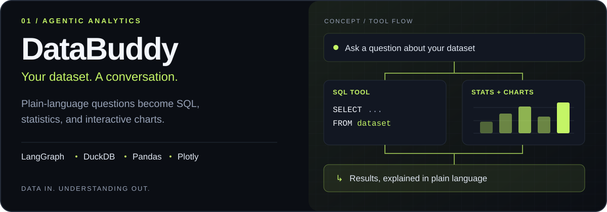
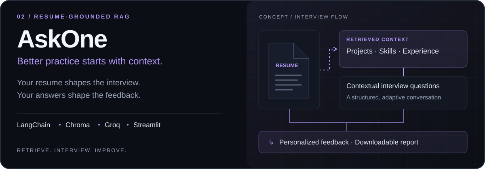
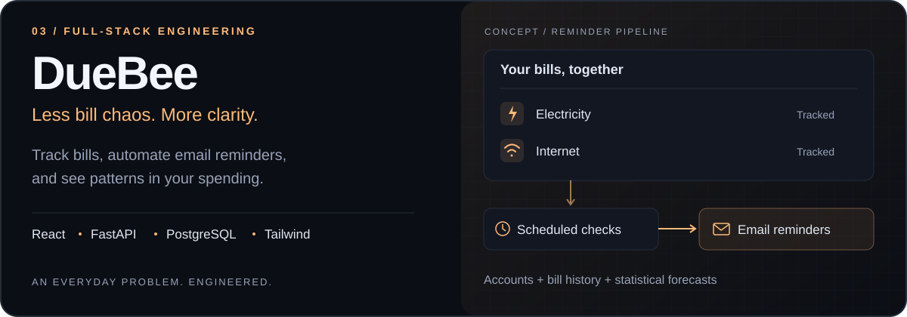
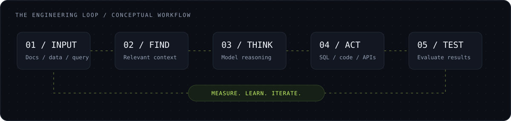
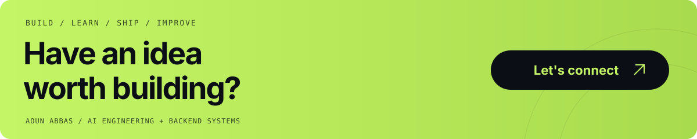

<!-- Custom artwork lives in assets/. Previous design: archive/navy-mint-profile. -->

  

  <a href="#01--the-builder"><strong>THE BUILDER</strong></a> &nbsp; / &nbsp;
  <a href="#02--selected-systems"><strong>SELECTED SYSTEMS</strong></a> &nbsp; / &nbsp;
  <a href="#03--the-toolkit"><strong>TOOLKIT</strong></a> &nbsp; / &nbsp;
  <a href="https://www.linkedin.com/in/aoun-abbas-dev"><strong>LET'S TALK ↗</strong></a>

 

## 01 / The builder

**I'm Aoun. I connect models to the things people actually need to do.**

That means turning documents into interview practice, datasets into answers, and everyday tasks into usable software. My focus is the engineering around AI: retrieval, tools, data systems, APIs, evaluation, and deployment.

<table>
<tr>
<td width="50%" valign="top">
<h3>What I work on</h3>

Generative AI · Retrieval-augmented generation · Agent workflows · Backend systems

</td>
<td width="50%" valign="top">
<h3>How I work</h3>

Build something useful. Understand where it breaks. Learn from it. Make the next version better.

</td>
</tr>
</table>

 

## 02 / Selected systems

Three projects. Three different engineering problems. **Explore the apps or follow the implementation.**

**DataBuddy** · Upload a CSV or Excel file, ask a question, and explore computed results with charts and explanations.

**[Launch app ↗](https://databuddyhere.streamlit.app/)** &nbsp; · &nbsp; [Read the code](https://github.com/aounkazmi-dev/DataBuddy)

 

**AskOne** · Practice a structured technical interview grounded in your resume, then download personalized feedback.

**[Launch app ↗](https://askone.onrender.com)** &nbsp; · &nbsp; [Read the code](https://github.com/aounkazmi-dev/AskOne)

 

**DueBee** · Track bills with account-based access, automated email reminders, spending insights, and statistical forecasts.

**[Launch app ↗](https://duebee-chi.vercel.app)** &nbsp; · &nbsp; [Read the code](https://github.com/aounkazmi-dev/DueBee) &nbsp; · &nbsp; [API docs](https://duebee-backend.onrender.com/docs)

 

<strong>Explore the rest of the work →</strong>

 

| Project | What it explores |
| :--- | :--- |
| [Laptop price prediction](https://github.com/aounkazmi-dev/Laptop-price-prediction) | Machine learning for price prediction |
| [News classifier](https://github.com/aounkazmi-dev/News-classifier) | Text classification and NLP |
| [C++ projects](https://github.com/aounkazmi-dev?tab=repositories&q=&type=&language=c%2B%2B) | Programming fundamentals and application design |
| [Problem-solving practice](https://github.com/aounkazmi-dev/neetcode-submissions) | Data structures and algorithms |

[Browse every repository ↗](https://github.com/aounkazmi-dev?tab=repositories)

 

## 03 / The toolkit

| Layer | What I use |
| :--- | :--- |
| **Languages** | Python · C++ · JavaScript · SQL |
| **Models & ML** | TensorFlow · scikit-learn · NLP · Transformers |
| **Agents & retrieval** | LangChain · LangGraph · RAG · Tool calling · MCP · Chroma · FAISS |
| **Data & analysis** | DuckDB · Pandas · NumPy · Plotly |
| **APIs & storage** | FastAPI · REST APIs · PostgreSQL |
| **Interfaces & delivery** | React · Tailwind CSS · Streamlit · Docker · Git |

 

## 04 / From input to useful output

The workflow I keep coming back to: find the right context, choose the right tools, and evaluate the result.

 

## 05 / The next iteration

<strong>Learning in public</strong>

- **Retrieval quality** — embeddings, search strategies, and RAG evaluation.
- **Agent design** — tool selection, orchestration, and multi-agent workflows.
- **Model foundations** — deep learning, NLP, transformers, and inference.
- **Production engineering** — backend architecture, deployment, and MLOps.

 

<strong>Education & foundations</strong>

 

**BS Computer Science · FAST-NUCES Lahore**  
2024–2028 · GPA **3.5+ / 4.00** · Dean's List for three consecutive semesters

**Machine Learning Specialization**  
Andrew Ng · DeepLearning.AI

 

<strong>GitHub activity</strong>

 

[View contributions on GitHub ↗](https://github.com/aounkazmi-dev)

 
 

  <a href="https://www.linkedin.com/in/aoun-abbas-dev"><strong>LinkedIn ↗</strong></a> &nbsp; · &nbsp;
  <a href="https://github.com/aounkazmi-dev?tab=repositories"><strong>Explore my repositories ↗</strong></a>

