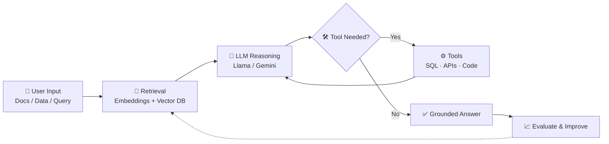

<!-- ================= HEADER ================= -->
<div align="center">


<a href="https://git.io/typing-svg">
  
</a>

<br/>

<a href="https://www.linkedin.com/in/aoun-abbas-dev"></a>
<a href="https://github.com/aounkazmi-dev"></a>


</div>

<br/>

## 👋 About Me

```python
class Aoun:
    def __init__(self):
        self.role      = "CS Undergrad @ FAST-NUCES Lahore"
        self.focus     = ["Generative AI", "RAG", "AI Agents", "Backend Systems"]
        self.building  = "The engineering layer around AI, not just the models"
        self.gpa       = "3.5+ / 4.00 (Dean's List x3)"
        self.mantra    = "Build → Learn → Ship → Improve"
```

I go beyond model training and focus on what makes AI **actually work in production**: **RAG pipelines, agentic workflows, tool calling, APIs, data systems, evaluation, and deployment.**

<br/>

## 🧠 What I Build

<div align="center">

| 🤖 AI / ML | ⚙️ AI Engineering | 🗄️ Data & Backend |
|:---|:---|:---|
| Machine Learning | LangChain / LangGraph | Python & SQL |
| Deep Learning | Tool Calling & MCP | Pandas / NumPy |
| NLP & Transformers | Vector Search (Chroma / FAISS) | DuckDB / PostgreSQL |
| LLM Applications | FastAPI LLM APIs | REST APIs |
| RAG Systems & Agents | Model Evaluation | System Design |

</div>

<br/>

## 🚀 Featured Projects

<table>
<tr>
<td width="33%" valign="top">

### 🎤 AskOne AI
**AI resume interviewer**

Analyzes an uploaded resume and runs a contextual interview using retrieval-augmented generation.


`Llama 3.3` `Gemini Embeddings`

**[→ View Repository](https://github.com/aounkazmi-dev/AskOne)**

</td>
<td width="33%" valign="top">

### 📊 DataBuddy
**Agentic AI data analyst**

Loads datasets, generates analysis, runs SQL and statistical operations, and returns insights through a structured LangGraph workflow.


**[→ Try the Live Demo](https://databuddyhere.streamlit.app/)**

</td>
<td width="33%" valign="top">

### 🐝 DueBee
**Full-stack bill reminder system**

Production-style web app for bills and automated reminders: auth, scheduled jobs, email notifications, PostgreSQL backend.


**[→ View Repository](https://github.com/aounkazmi-dev/DueBee)**

</td>
</tr>
</table>

<br/>

## 🔄 How My AI Systems Work



<br/>

## 🛠️ Tech Stack

<div align="center">


<br/><br/>


</div>

<br/>

## 📈 GitHub Stats

<div align="center">


<br/>


<br/>


</div>

<br/>

## 📚 Currently Learning

```text
Advanced ML  →  Deep Learning & NLP  →  LLMs & Transformers
      →  RAG & Retrieval Systems  →  Agentic AI & Tool Use
      →  AI System Design & Production Engineering
```

- 🔬 LLM architecture and inference
- 🎯 RAG evaluation and retrieval optimization
- 🕸️ Agent architectures and multi-agent workflows
- 🏗️ AI system design and backend architecture
- 🚢 MLOps and production AI

<br/>

## 🎓 Education & Certifications

<div align="center">

| | |
|:---|:---|
| 🏛️ **FAST-NUCES Lahore** | BS Computer Science · 2024 – 2028 |
| ⭐ **GPA** | 3.5+ / 4.00 · Dean's List, 3 consecutive semesters |
| 📜 **Machine Learning Specialization** | Andrew Ng · DeepLearning.AI |

</div>

<br/>

## 🤝 Let's Connect

<div align="center">

Interested in **AI engineering, GenAI, ML systems, or building useful AI products**? Let's talk.

<a href="https://www.linkedin.com/in/aoun-abbas-dev"></a>
<a href="https://github.com/aounkazmi-dev"></a>

</div>


